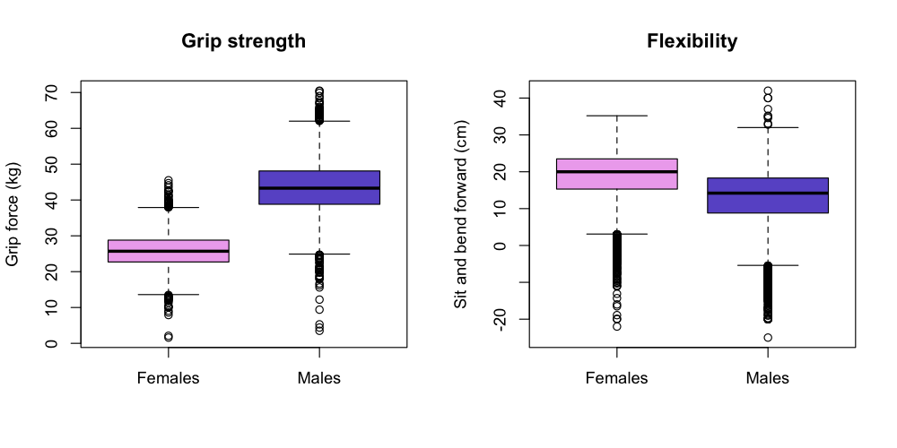
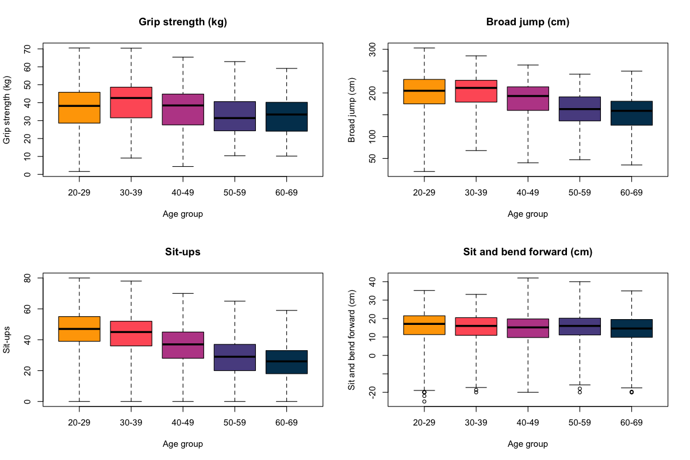
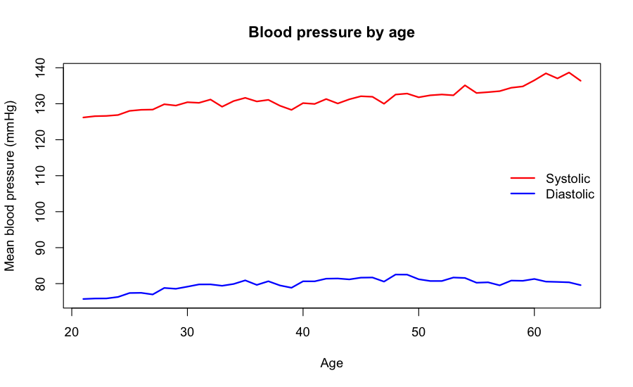
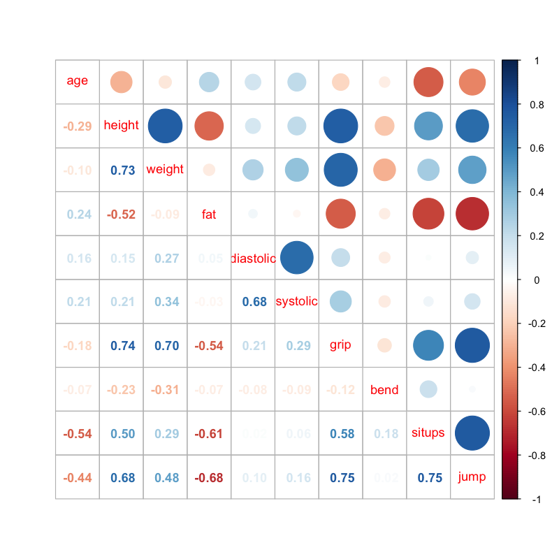
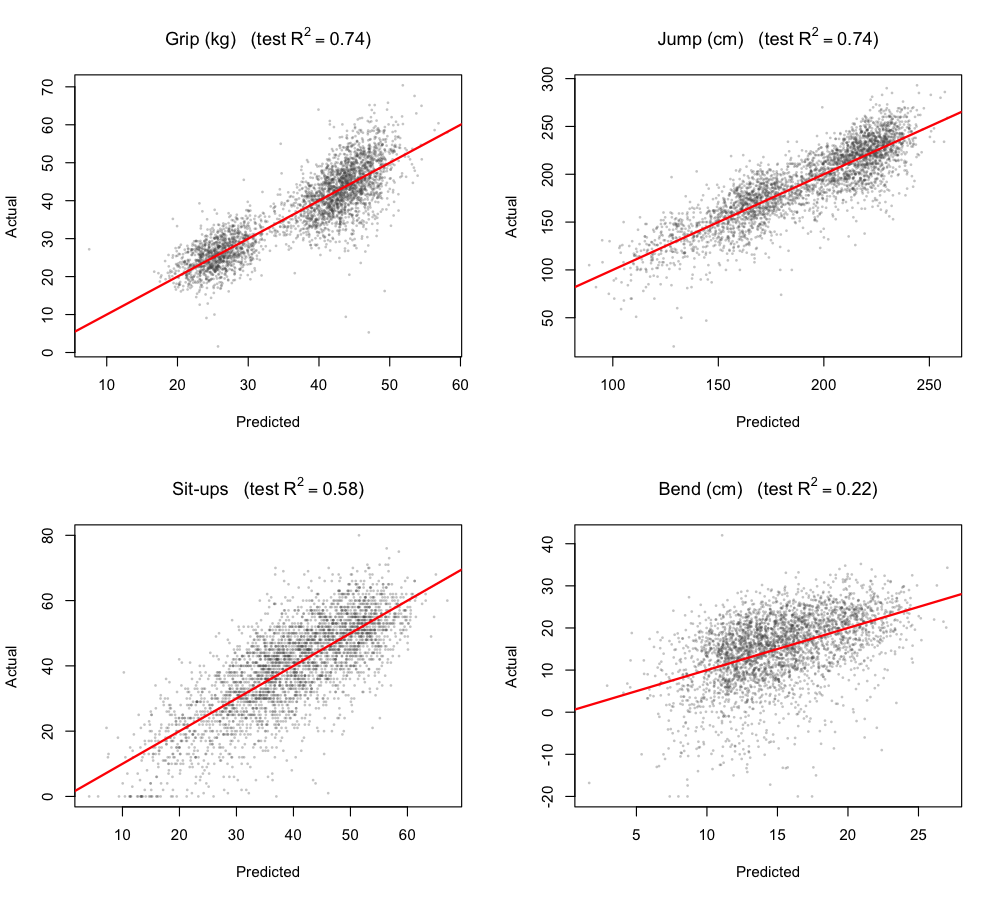

# Body Performance Analysis

Exploratory data analysis and regression in R on the [Body Performance](https://www.kaggle.com/datasets/kukuroo3/body-performance-data) dataset: ~13k adults (age 21–64), with body measurements, blood pressure and four fitness tests (grip, sit-and-bend, sit-ups, broad jump).

## Results so far

**Cleaning.** 13,393 rows → 13,332 after removing impossible values (BP = 0, grip/jump = 0, bend = 213 cm, …). Thresholds follow Lu et al. 2020.

**Sample.** 8,438 men / 4,894 women. Age groups: 20s 5,761 · 30s 2,652 · 40s 1,858 · 50s 1,735 · 60s 1,326.

**Men vs women.**
| | Women | Men |
|---|---|---|
| Height (cm) | 160.5 | 173.3 |
| Body fat (%) | 28.5 | 20.2 |
| Grip (kg) | 25.8 | 43.5 |
| Sit and bend (cm) | 18.9 | 13.0 |

Men have stronger grip and women are more flexible (Welch t-tests, both p < 0.001).

**Age.** Sit-ups and jump fall clearly with age. Grip peaks in the 30s. Flexibility barely changes.

**Blood pressure.** Systolic BP rises by about 0.22 mmHg per year (r = 0.21) and climbs faster after ~55. Diastolic rises until ~50, then flattens.

**Correlations.** Strongest pairs: grip–jump r = 0.75, height–weight 0.73, height–jump 0.68, systolic–diastolic 0.68. Age–sit-ups r = −0.54.

## Regression (`regression.R`)

Each fitness test is predicted from age, age², gender, height, weight, body fat and blood pressure. Data split 75/25 into train/test. Variables are dropped one at a time with 5-fold CV until removing another one would make CV RMSE more than 1% worse.

| Outcome | Kept variables | CV RMSE | Test RMSE | Train R² |
|---|---|---|---|---|
| Grip (kg) | age, age², gender, weight, fat | 5.17 | 5.33 | 0.76 |
| Jump (cm) | age, age², gender, weight, fat | 20.1 | 20.0 | 0.74 |
| Sit-ups | age, gender, height, weight, fat | 9.08 | 9.16 | 0.60 |
| Bend (cm) | gender, weight, fat | 7.16 | 7.30 | 0.22 |

- Test RMSE ≈ CV RMSE everywhere, so the models do not overfit.
- Blood pressure was dropped from every model.
- Grip peaks around age 38 in the model, jump around age 21.
- Body fat always has a negative effect. Holding the rest fixed, +1% fat ≈ −0.5 kg grip, −2.2 cm jump, −1 sit-up.
- Flexibility is hard to predict from body measurements (R² 0.22).
- The largest residuals (e.g. young men with very low grip) have Cook's distance ≤ 0.014. Refitting without them leaves the coefficients almost unchanged.

Predicted vs actual on the test set (red line = perfect prediction). Grip and jump fall close to the line; bend is a wide cloud. The two clusters in grip are women (left) and men (right).

## Files
- `bodyPerformance.csv`: the dataset
- `01_cleaning.R`: import, rename columns, remove impossible values, add BMI and age groups
- `02_overview.R`: summary, gender, age
- `03_height.R`: height
- `04_weight_fat.R`: weight and body fat
- `05_blood_pressure.R`, `Systolic and dyastolic pressure with regression.R`: blood pressure
- `06_performance.R`: grip, flexibility, sit-ups, broad jump
- `07_age_groups.R`: comparisons across age groups
- `pairs_corr.R`: pair plots and correlation matrices (needs `corrplot`)
- `regression.R`: regression with cross-validation
- `08_predictor_draft.R`: draft, not finished
- `figures/`: plots used in this README
- `grip_force_Bohannon2019.pdf`: reference for grip force
- `old/`: old drafts

## Run
The scripts run `01_cleaning.R` themselves. Base R only, except `corrplot` (correlations) and `ggplot2` (blood pressure script).

Citation for filtering criteria: Lu Y, Huang C, Mahajan S, Schulz WL, Nasir K, Spatz ES, Krumholz HM. Leveraging the Electronic Health Records for Population Health: A Case Study of Patients With Markedly Elevated Blood Pressure. J Am Heart Assoc. 2020 Apr 7;9(7):e015033. doi: 10.1161/JAHA.119.015033. Epub 2020 Mar 23. PMID: 32200730; PMCID: PMC7428633.
